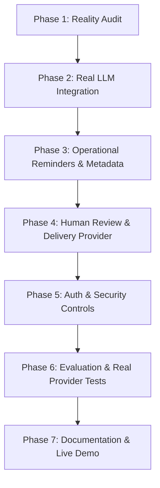

# HealthTrack — Product Reality Audit & Status Report

**Document Date**: 2026-10-11  
**Project Location**: `C:\Users\vaish\.gemini\antigravity-ide\scratch\healthtrack`  
**Audit Scope**: Verification of current codebase capabilities, abstractions, external integrations, security controls, and operational readiness.

---

## Executive Summary

HealthTrack currently operates as a verified **offline prototype and test harness**, not a production-ready product. It possesses robust local database modeling, transactional isolation, UTC datetime normalization, regex-based heuristic guardrails, and deterministic template generation. 

However, **all external provider connections (both LLM and delivery transport) are stubs or non-existent**. The application runs purely offline. When configured for external AI, it raises `NotImplementedError` and silently falls back to deterministic templates. No authentication, human-in-the-loop review workflow, or delivery tracking exists.

---

## Detailed Capability Matrix

| Product Domain | Implemented (Verified) | Partially Implemented | Unimplemented / Absent | Unverified |
| :--- | :--- | :--- | :--- | :--- |
| **Data & Persistence** | • SQLite ORM models (`Patient`, `Appointment`, `FollowUpReminder`)<br>• UTC timezone normalization via `UTCDateTime`<br>• SQLite foreign key enforcement (`PRAGMA foreign_keys=ON`)<br>• Unique constraint on `appointment_id`<br>• Nested transaction savepoints for batch isolation | • Schema evolution: relies on `Base.metadata.create_all()` without Alembic migrations.<br>• `ReminderStatus` enum defines `DRAFT`, `PENDING`, `SENT`, `FAILED`, but only `DRAFT` is ever assigned. | • Metadata tracking for generation origin (AI vs. template fallback).<br>• Audit trails for review approvals or delivery attempts.<br>• Delivery tracking identifiers (provider message IDs, webhook payloads). | • Multi-worker database concurrency under PostgreSQL. |
| **Eligibility & Scheduling** | • Lookback window logic (`[reference_time - 7 days, reference_time)`)<br>• Injectable reference timestamp for testing<br>• Idempotent deduplication (skips appointments with existing reminders) | • Window length configurable via API parameter (`window_days`, 1–90 days). | • Automated cron or scheduled background workers (currently requires manual REST trigger). | None. |
| **AI Personalization** | • Template-based deterministic personalizer (`TemplateMessagePersonalizer`)<br>• Input sanitizer stripping newlines and control characters<br>• Server-controlled prompt template<br>• Regex-based guardrails (length, greeting, medical advice, dates, injection echo)<br>• Fallback orchestrator (`GuardrailedAIPersonalizer`) | • `ConfiguredLLMClient` checks env flags (`LLM_PROVIDER`, `LLM_API_KEY`).<br>• Generic exception handler catches provider errors and falls back to template. | • **Real LLM provider integration**: `ConfiguredLLMClient.generate()` explicitly raises `NotImplementedError`. No SDK (OpenAI, Gemini, Anthropic) is invoked.<br>• Provider error reporting to client: provider failures are silently masked as template successes. | • Live LLM latency, token usage, rate limit handling, and cost. |
| **Message Delivery** | None. | None. | • Delivery provider abstraction (SMS / Email).<br>• Provider integration (e.g., Twilio, SendGrid, AWS SES).<br>• Delivery status transition (`PENDING` -> `SENT` / `FAILED`).<br>• Webhook verification and receipt tracking. | • Outbound deliverability and phone/email validation. |
| **Human Review & Approval** | • Reminders created in `DRAFT` status. | None. | • Endpoints to list draft reminders.<br>• Endpoints to review, edit, approve, or reject drafts.<br>• Approval audit log (`approved_by`, `approved_at`). | • Clinical user review interface. |
| **Security & Auth** | • Synthetic PII fixtures in tests.<br>• Sanitization of patient name inputs.<br>• Privacy-conscious logging (internal IDs only; no patient names, emails, or prompts logged). | • Environment variable configuration via Pydantic Settings. | • Authentication (no API key, JWT, or session auth on any endpoint).<br>• Authorization / RBAC (admin vs. clinical reviewer).<br>• Request rate limiting.<br>• CORS and CSRF configuration. | • HIPAA / BAA compliance for third-party LLM or delivery data transit. |
| **Evaluation & Testing** | • 69 unit/integration tests with 100% pass rate.<br>• In-memory SQLite isolation per test.<br>• Offline synthetic benchmark (16 cases) measuring baseline vs. guarded pass rates. | • `evals/run.py` evaluates synthetic candidate strings against ground-truth labels. | • Real-provider integration test suite.<br>• Semantic evaluation (LLM judge or clinical evaluation). | • Real-world LLM adherence on uncurated patient demographics. |

---

## Deep Dive: Critical Reality Audit Findings

### 1. Real LLM Provider Status: Stub Only (`NotImplementedError`)
- In `app/services/llm_client.py`:
  ```python
  class ConfiguredLLMClient:
      ...
      def generate(self, prompt: str, timeout: Optional[float] = None) -> str:
          if not self.is_configured:
              raise LLMProviderError("No external LLM provider configured...")
          # In this local assessment foundation, live network calls are intentionally not executed.
          raise NotImplementedError("Live LLM integration is disabled in this environment.")
  ```
- **Silent Fallback Defect**: In `app/services/ai_personalizer.py`, `GuardrailedAIPersonalizer.personalize_reminder()` wraps `llm_client.generate()` in `try ... except Exception:`. When `ConfiguredLLMClient` raises `NotImplementedError`, it logs a warning and falls back to `TemplateMessagePersonalizer`.
- **API Impact**: When an operator sets `LLM_PROVIDER="openai"` and an API key, calling `POST /api/v1/reminders/generate` succeeds with HTTP 200, but **every single reminder is generated by the template fallback**. Neither the API response nor the database records that the LLM failed or that a template was used.

### 2. Message Delivery Status: Completely Unimplemented
- No delivery provider exists in `app/services/` or `app/api/`.
- `ReminderStatus` defines `DRAFT`, `PENDING`, `SENT`, `FAILED`, but the codebase only writes `ReminderStatus.DRAFT`.
- There is no background worker, queue (Celery/RQ/Temporal), or webhook handler.

### 3. Authentication & Access Control: Completely Unimplemented
- `POST /api/v1/reminders/generate` and `GET /health` are completely open and unauthenticated.
- No user identity, tenant isolation, or role-based access control exists.
- Any network client can trigger batch reminder generation and inspect system health.

### 4. Database Schema Deficiencies for Production Operation
- The `follow_up_reminders` table contains only:
  `id`, `appointment_id`, `message_text`, `status`, `created_at`.
- It lacks fields required for auditability and delivery:
  - `generation_source`: `enum('ai', 'template_fallback')`
  - `llm_model`: string nullable
  - `fallback_reason`: string nullable
  - `approved_at`: datetime nullable
  - `approved_by`: string nullable
  - `sent_at`: datetime nullable
  - `delivery_provider`: string nullable
  - `delivery_reference_id`: string nullable
  - `delivery_error`: string nullable

### 5. Automated Tests and Evaluation Truth
- All 69 tests in `tests/` pass because they use:
  - `FakeLLMClient` (in `test_ai_personalizer.py`),
  - `TemplateMessagePersonalizer` (in `test_generator.py` and `test_api_reminders.py`), or
  - In-memory database fixtures.
- The 16 benchmark cases in `evals/dataset.py` test canned strings with predefined ground truth. The reported 100% guarded pass rate is achieved because failing cases trigger the template fallback, which always passes regex checks. It does not measure live LLM behavior.

---

## Architectural Blockers

1. **Missing Provider Adapter Implementation**:
   - `LLMClient` requires a genuine network client adapter (e.g. `OpenAILLMClient` using the installed `openai 2.4.0` SDK or `GoogleGenAILLMClient` using `google-genai`).
   - Need clear distinction between:
     - Missing configuration -> clear configuration error when real mode is demanded.
     - Live API errors (timeout, rate limit, auth) -> structured recording, validated fallback, and explicit metadata marking.
2. **Missing Schema Fields for Production Tracking**:
   - The ORM model `FollowUpReminder` cannot record generation origin (`ai` vs `fallback`), approval status, or delivery tracking without updating columns.
3. **Missing Human Review Workflow**:
   - Generating reminders directly to sent status without a review step violates clinical safety guidelines for patient-facing messaging. An approval step is architecturally necessary before delivery.
4. **Missing Authentication Layer**:
   - Patient-associated endpoints cannot be safely exposed without an API key or bearer token authentication dependency.

---

## Prioritized Implementation Plan (Phases 2 – 7)



### Phase 2: Genuine LLM Integration
- **Objective**: Implement a live, production-grade LLM provider adapter using the official provider SDK.
- **Provider Choice**: Use `openai` SDK (v2.4.0 is already installed in the local environment and `OPENAI_API_KEY` is present in the local environment) or supported Google Gen AI SDK.
- **Architecture**:
  - Implement `OpenAILLMClient` implementing `LLMClient` protocol with explicit model (`gpt-4o-mini` or configured model), timeout handling, exponential backoff/retries, and safe error mapping (`LLMAuthError`, `LLMRateLimitError`, `LLMTimeoutError`).
  - Configure strict prompt boundaries: patient inputs injected strictly as untrusted text, zero PII (no IDs, no emails, no notes).
  - Explicit configuration error: If `LLM_PROVIDER="openai"` and `OPENAI_API_KEY` is empty, raise `LLMConfigurationError` rather than silently succeeding or falling back.
  - Maintain `FakeLLMClient` as a strictly named test double for unit tests.
  - Add live-provider integration test with `@pytest.mark.skipif(not has_credentials, reason=...)`.

### Phase 3: Operational Reminders, Metadata & Database Integrity
- **Objective**: Make reminder generation auditable, resilient, and transparent.
- **Architecture**:
  - Update `FollowUpReminder` model to persist generation metadata: `generation_source` (`ai` vs `fallback`), `provider`, `model_name`, `fallback_reason`.
  - Expand `ReminderStatus` to support the full operational lifecycle: `draft`, `approved`, `queued`, `sent`, `failed`, `cancelled`.
  - Strengthen error responses in `POST /api/v1/reminders/generate` to report detailed batch breakdowns: count of AI-generated vs. fallback-generated records.
  - Update tests to verify database schema and state transitions.

### Phase 4: Human Review & Delivery Provider Interface
- **Objective**: Establish clinical safety controls before patient dispatch and integrate a genuine delivery transport.
- **Architecture**:
  - Implement review endpoints:
    - `GET /api/v1/reminders/drafts`: List pending drafts with patient and appointment context.
    - `POST /api/v1/reminders/{id}/approve`: Authorized approval transitioning reminder to `approved`.
    - `POST /api/v1/reminders/{id}/reject`: Reject inappropriate drafts.
  - Implement Delivery Service Protocol (`DeliveryProvider`):
    - Concrete delivery provider implementation (e.g. SMTP / SendGrid / Twilio API).
    - Dispatch endpoint: `POST /api/v1/reminders/{id}/send` (only eligible for `approved` reminders).
    - Idempotency check: prevent duplicate dispatches.
    - Persist `sent_at`, `delivery_provider`, and `delivery_reference_id`.
    - Safe default: delivery disabled by default (`DELIVERY_ENABLED=false`) until explicitly activated with verified test recipient.

### Phase 5: Authentication, Authorization & Operational Security
- **Objective**: Secure all clinical endpoints and ensure operational auditability.
- **Architecture**:
  - Add API key authentication dependency (`X-API-Key` or `Authorization: Bearer <token>`).
  - Secure endpoints: require authenticated admin for batch generation and approval.
  - Add request payload limits and rate limiting.
  - Audit logging for administrative actions without leaking patient PII.

### Phase 6: Comprehensive Verification & Evaluation
- **Objective**: Provide honest, separated test reports.
- **Architecture**:
  - Clearly delineate:
    1. Unit tests (deterministic test doubles).
    2. Offline synthetic benchmark (canned cases).
    3. Live LLM integration tests (executed against real provider if credentials exist).
    4. Delivery integration tests (skipped if credentials absent or delivery disabled).
  - Document evaluation limitations honestly: regex guardrails do not equal clinical safety certification.

### Phase 7: Product Documentation & Live Demonstration
- **Objective**: Finalize documentation and verify end-to-end execution.
- **Architecture**:
  - Update `README.md`, `PRODUCT_STATUS.md`, and `DEMO_SCRIPT.md`.
  - Provide complete curl and CLI scripts for setting up env, running real AI generation, approving drafts, and observing database audit records.

---

## Immediate Next Action
Phase 1 reality audit is complete. Awaiting user review and authorization before proceeding with **Phase 2: Real LLM Integration**.
