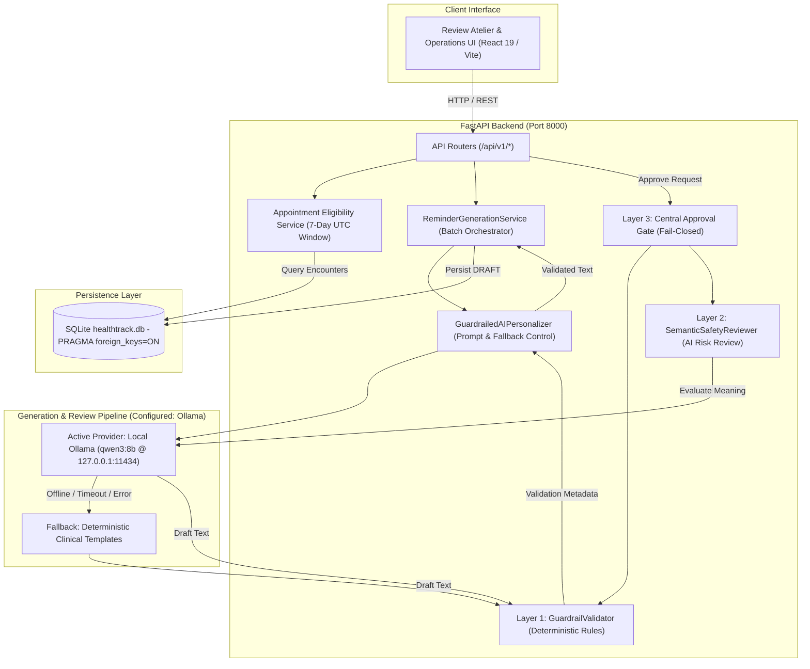
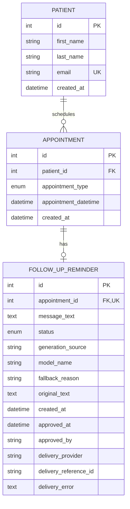

# HealthTrack — AI-Driven Patient Follow-Up System

HealthTrack is an administrative healthcare backend and review atelier designed to automate, personalize, and validate post-encounter patient follow-up communications. Built for clinical care coordinators and healthcare operations administrators, HealthTrack bridges the gap between post-visit encounter data and empathetic patient communication while enforcing strict deterministic safety guardrails and human-in-the-loop oversight.

> **Project Assessment Submission**: AidenAI AI Engineer Build-Round<br/>
> **Repository**: [https://github.com/VaishnavSreekumar/Health_Tracker](https://github.com/VaishnavSreekumar/Health_Tracker)<br/>
> **Operational Status**: Fully Functional (FastAPI Backend + Vite/React 19 Atelier UI + Multi-Tier LLM Pipeline with Deterministic Fallback)

---

## 1. System Scope & Architecture

### 1.1 Key Capabilities
- **7-Day Retrospective Encounter Selection**: Identifies patient encounters completed within a deterministic 7-day UTC lookback window (`[reference_time - 7 days, reference_time)`), strictly excluding future scheduled appointments.
- **Local AI Inference via Ollama (`qwen3:8b`)**: Privacy-first, zero-quota local runtime execution (`http://127.0.0.1:11434`) powering both context-aware patient follow-up message generation and semantic safety review, with reliable fallback to deterministic clinical templates if the local service is offline. (Hosted OpenRouter model failover and Google Gemini are also supported under separate configurations).
- **Layered Safety Architecture**:
  - **Layer 1 — Deterministic Guardrails (`GuardrailValidator`)**: Pre-persistence checks enforcing character bounds (15–350 chars), neutral greetings, PII redaction, prompt injection shields, and terminal punctuation completeness.
  - **Layer 2 — AI Semantic Risk Review (`SemanticSafetyReviewer`)**: Contextual semantic safety evaluation evaluating message meaning rather than keyword matching to detect medication directives, dosage/quantity ambiguities (e.g., "two strips"), clinical claims, and context contradictions.
  - **Layer 3 — Central Approval Gate**: Fail-closed server-side authorization blocking unverified messages, timeouts, or flagged outputs before a draft can transition to `APPROVED`.
  - **Layer 4 — Safe Dispatch Boundaries**: Messages are gated behind approved status and rejected with HTTP 503 to ensure zero live transmissions during testing.
- **Human-in-the-Loop Review Atelier**: Administrative interface allowing clinical staff to inspect draft provenance, edit message text, trigger live guardrail re-validation, approve, or reject drafts.

### 1.2 Explicit Non-Goals
- **No Direct Patient Portal**: HealthTrack is exclusively an internal clinical operations tool; patients do not log into the system.
- **No External Message Transmission**: External SMS/WhatsApp gateways (e.g., Twilio) and email providers (e.g., SendGrid) are unconfigured by default. The `/dispatch` endpoint explicitly rejects outbound transport with HTTP 503 to ensure zero unsanctioned patient communication during evaluation.
- **No Automated Clinical Diagnosis or Medical Triage**: The system strictly forbids generating clinical advice, diagnosis, prescription adjustments, or medical instructions.

### 1.3 System Architecture Diagram



---

## 2. Relational Data Models & Database Architecture

HealthTrack uses **SQLAlchemy 2.x** with a local SQLite database (`healthtrack.db`). SQLite foreign-key enforcement is enabled on connection via `PRAGMA foreign_keys = ON`. Timestamps are stored and normalized using timezone-aware UTC datetime wrappers (`UTCDateTime`).

### 2.1 Entity Model Specifications
- **`Patient` (`patients`)**: Primary patient entity storing `first_name`, `last_name`, synthetic unique `email`, and registration `created_at`.
- **`Appointment` (`appointments`)**: Clinical encounter linked to `Patient` via `patient_id`. Categorized by `AppointmentType` enum (`ROUTINE_CHECKUP`, `FOLLOW_UP`, `SPECIALIST_CONSULTATION`, `ANNUAL_PHYSICAL`, `POST_PROCEDURE`). Stores `appointment_datetime` (UTC) and `created_at`.
- **`FollowUpReminder` (`follow_up_reminders`)**: Follow-up message linked to `Appointment` via `appointment_id`. Enforces a strict one-reminder-per-appointment integrity constraint via a unique database index (`uq_follow_up_reminders_appointment_id`).
  - **Message & Status**: Stores `message_text`, optional `original_text` for review diffs, and `status` via `ReminderStatusType` mapping to `ReminderStatus` enum (`DRAFT`, `APPROVED`, `REJECTED`, `PENDING`, `SENT`, `FAILED`).
  - **Status Normalization**: `ReminderStatusType` transparently normalizes legacy lowercase database values (e.g. `draft`) while persisting canonical uppercase enum names (`DRAFT`, `APPROVED`, etc.) to storage.
  - **Operational Provenance**: Stores `generation_source` (`ai` or `template_fallback`), `model_name`, and `fallback_reason`.
  - **Human Review**: Stores `approved_at` and `approved_by`.
  - **Delivery Tracking**: Stores `delivery_provider`, `delivery_reference_id`, and `delivery_error` directly on the reminder entity.

### 2.2 Entity Relationship Diagram (ERD)



---

## 3. Reminder Generation, Safety Guardrails & Human-in-the-Loop Lifecycle

### 3.1 7-Day Lookback & Duplicate Prevention
- Encounter selection evaluates appointments matching `reference_time - 7 days <= appointment_datetime < reference_time`.
- Future appointments (`appointment_datetime >= reference_time`) are strictly excluded.
- Idempotency is guaranteed: encounters with an existing reminder record (`DRAFT`, `APPROVED`, `REJECTED`, etc.) are skipped during batch generation.

### 3.2 5-Tier Deterministic Guardrail Validation
Every generated or staff-edited message must pass the 5-tier guardrail filter (`app/services/guardrails.py`):
1. **Length Bounds**: Message length must be between 15 and 350 characters.
2. **Personalized Greeting**: Message must open with a personalized greeting addressing the patient by name (e.g., "Hello [Name]").
3. **Prompt & Injection Isolation**: Strict rejection of system prompt leakage, Markdown syntax, internal schema identifiers, bracketed template variables (e.g., `[Patient Name]`), or role markers (`SYSTEM:`, `ASSISTANT:`).
4. **Non-Prescriptive Clinical Safety**: Strict prohibition of medical diagnoses, prescription medication names, dosage instructions, or definitive clinical advice.
5. **Structural & Sentence Completeness**: Requires terminal punctuation (`.`, `!`, `?`), forbids abrupt truncation, and rejects sentences ending in dangling conjunctions or prepositions (`and`, `with`, `because`).

### 3.3 Layered Safety Review & Approval Gate
HealthTrack combines fast deterministic filtering with deep contextual AI semantic safety review before authorizing any patient communication:

1. **Layer 1 — Deterministic Guardrails (`GuardrailValidator`)**:
   - Re-evaluates length bounds (15–350 chars), personalized greeting integrity, prompt injection attempts, and complete sentence termination.
2. **Layer 2 — AI Semantic Risk Review (`SemanticSafetyReviewer`)**:
   - Analyzes message **meaning and context** rather than searching for fixed keywords.
   - Evaluates whether the proposed reminder directs medication start/stop/alterations, prescribes dosages or frequencies, uses ambiguous non-standard packaging quantities (e.g., "two strips"), asserts clinical diagnoses, makes unsupported claims, contradicts encounter dates, or contains prompt injections.
   - Treats the candidate draft and patient fields strictly as **untrusted data** inside an isolated prompt boundary.
3. **Layer 3 — Central Fail-Closed Approval Gate (`POST /api/v1/reminders/{id}/approve`)**:
   - Gated server-side; the UI is not a security boundary.
   - Evaluates the **current draft** at the point of approval.

#### Fail-Closed Approval Policy

| Evaluation Condition | Approval Decision | HTTP Status | Behavioral Impact |
| :--- | :---: | :---: | :--- |
| Layer 1 Deterministic Check Fails | **Blocked** | `400 Bad Request` | Returns specific violation (e.g. missing greeting, terminal punctuation). |
| Layer 2 Semantic Reviewer returns `flag` | **Blocked** | `400 Bad Request` | Returns flagged risk categories and concise explanation; draft remains unapproved. |
| Layer 2 Semantic Reviewer returns `uncertain` | **Blocked** | `400 Bad Request` | Blocks approval pending formal clinical staff manual audit. |
| Semantic Reviewer Times Out or Outage | **Blocked** | `503 Service Unavailable` | Never assumes safety on provider downtime. Fails closed safely. |
| Reviewer Output Invalid or Malformed JSON | **Blocked** | `502 Bad Gateway` | Strict Pydantic schema validation rejects unparseable output. |
| Both Layer 1 and Layer 2 Pass (`allow`) | **Approved** | `200 OK` | Transitions reminder to `APPROVED` and records audit provenance. |
| Draft Message Edited after Prior Review | **Invalidated** | `200 OK` (on edit) | `PATCH /{id}` clears previous review metadata, forcing fresh evaluation on approval. |

#### Regression Defense: "Take antibiotics two strips."
In initial keyword-based guardrails, the message *"Hello Alice, following up on your appointment. Take antibiotics two strips."* was mistakenly accepted because `\bantibiotic\b` only matched singular nouns and "two strips" did not match numeric expressions like `\d+ mg` or `take \d+`.

Under the new semantic review layer, this instruction is evaluated for clinical meaning, correctly classified under `ambiguous_quantity` and `medication_instruction`, and immediately blocked from approval.

### 3.4 Reminder Lifecycle State Machine

```mermaid
stateDiagram-v2
    [*] --> Eligible: Encounter within 7-day UTC lookback window
    Eligible --> DRAFT: AI or Template Generation (Passes Guardrails)

    state DRAFT {
        [*] --> PendingReview
        PendingReview --> StaffEdited: PATCH /{id} (Edits text; invalidates prior review)
        StaffEdited --> PendingReview: Re-validated locally
    }

    DRAFT --> APPROVED: POST /{id}/approve (Layer 1 deterministic & Layer 2 semantic review pass)
    DRAFT --> REJECTED: POST /{id}/reject
    DRAFT --> DRAFT: POST /{id}/approve (Semantic flag / uncertain -> HTTP 400 Blocked)
    DRAFT --> DRAFT: POST /{id}/approve (Provider timeout / 503 -> HTTP 503 Blocked)

    APPROVED --> [*]: Kept in Clinic Record
    APPROVED --> HTTP_503: POST /{id}/dispatch (External delivery unconfigured)
    REJECTED --> [*]
```



### 3.5 Delivery Dispatch Behavior & Logging
- **`POST /api/v1/reminders/{id}/dispatch`**: Verifies that the reminder is in `APPROVED` status. When no external SMS or email provider is configured, the endpoint returns **`HTTP 503 Service Unavailable`** with detail:
  ```json
  {"detail": "External message delivery provider is unconfigured. Safe local demonstration mode is active."}
  ```
  This guarantees that messages are never transmitted over live telecommunications networks during local testing or evaluation.
- **`GET /api/v1/delivery/logs`**: Queries `FollowUpReminder` records where status is in `SENT`, `FAILED`, or `PENDING` to inspect outbound delivery history.

---

## 4. API Reference

All API routes are prefixed under `/api/v1` (with the exception of `/health`).

### Core Endpoints

| Method | Path | Description | Key Parameters / Request Body | Response Status & Key Fields |
| :--- | :--- | :--- | :--- | :--- |
| `GET` | `/health` | System liveness, database connectivity, and configured LLM provider status. | None | `200 OK`: `{"status": "healthy", "database": "connected", "primary_provider": "...", "configured_model": "..."}` |
| `GET` | `/api/v1/patients/` | Retrieve list of registered patients. | None | `200 OK`: `List[PatientResponse]` (`id`, `first_name`, `last_name`, `email`, `created_at`) |
| `POST` | `/api/v1/patients/` | Register a new patient. | `{"first_name": "...", "last_name": "...", "email": "..."}` | `201 Created`: `PatientResponse` |
| `GET` | `/api/v1/appointments/` | Retrieve appointments with patient and reminder context. | `?eligible_only=false&reference_time=...` | `200 OK`: `List[AppointmentResponse]` |
| `POST` | `/api/v1/appointments/seed-qa` | Seed synthetic encounters for testing. | None | `200 OK`: `{"seeded": 5, "message": "..."}` |
| `GET` | `/api/v1/reminders/generate` | Batch generation endpoint (assessment evaluation contract). | `?window_days=7&reference_time=...&as_list=false` | `200 OK`: `ReminderGenerationResponse` (or `List[ReminderDetailResponse]` if `as_list=true`) |
| `POST` | `/api/v1/reminders/generate` | Standard RESTful batch generation trigger. | `{"window_days": 7, "reference_time": null}` | `200 OK`: `ReminderGenerationResponse` |
| `POST` | `/api/v1/reminders/appointments/{apt_id}/draft` | Generate or regenerate draft for a single encounter. | None (path parameter `appointment_id`) | `200 OK`: `ReminderDetailResponse` (`status="draft"`, provenance metadata) |
| `PATCH`| `/api/v1/reminders/{id}` | Edit draft message text. Automatically re-evaluates guardrails. | `{"message_text": "Updated reminder text..."}` | `200 OK`: `ReminderDetailResponse` (`is_edited=true`, updated validation breakdown) |
| `POST` | `/api/v1/reminders/{id}/approve` | Approve draft. Enforces live guardrail re-validation. | None (path parameter `reminder_id`) | `200 OK`: `ReminderDetailResponse` (`status="approved"`, `approved_at`, `approved_by`) |
| `POST` | `/api/v1/reminders/{id}/reject` | Reject draft. Transitions status directly to rejected. | None (path parameter `reminder_id`) | `200 OK`: `ReminderDetailResponse` (`status="rejected"`) |
| `POST` | `/api/v1/reminders/{id}/dispatch` | Message dispatch boundary. Returns 503 when external transport is unconfigured. | None (path parameter `reminder_id`) | `503 Service Unavailable`: Safe unconfigured notice |
| `GET` | `/api/v1/delivery/logs` | Retrieve outbound transmission log for reminders. | None | `200 OK`: `List[dict]` (`reminder_id`, `status`, `provider`, `reference_id`, `error_detail`) |
| `POST` | `/api/v1/system/reset` | Clear operational records to return to an empty workspace. | None | `200 OK`: `{"status": "success", "message": "All workspace records cleared."}` |

#### Batch Generation Parameters (`GET` & `POST /api/v1/reminders/generate`)
- `window_days` (integer, default: `7`, range: `1` to `90`): Number of past days to inspect for completed encounters.
- `reference_time` (datetime, optional): Anchor timestamp in UTC for controlled replay and evaluation. Defaults to current UTC time.
- `as_list` (boolean, default: `false`, `GET` only): When `true`, returns a flat JSON array of reminder records (`List[ReminderDetailResponse]`). When `false`, returns the full `ReminderGenerationResponse` containing summary metrics (`total_reviewed`, `reminders_created`, `reminders_skipped`, `failures`, `created_reminder_ids`, `reminders`).

---

## 5. Prerequisites & Verified Setup

### 5.1 System Prerequisites
- **Python**: 3.11 or newer
- **Node.js**: 18.0 or newer with `npm`
- **Git**

### 5.2 Backend Installation & Setup

1. **Clone the repository**:
   ```bash
   git clone https://github.com/VaishnavSreekumar/Health_Tracker.git
   cd Health_Tracker
   ```

2. **Create and activate a virtual environment**:
   ```bash
   # Windows PowerShell
   python -m venv .venv
   .venv\Scripts\Activate.ps1

   # Linux / macOS
   python3 -m venv .venv
   source .venv/bin/activate
   ```

3. **Install Python dependencies**:
   ```bash
   pip install -r requirements.txt
   ```

4. **Configure environment variables**:
   ```bash
   # Windows PowerShell
   Copy-Item .env.example .env

   # Linux / macOS
   cp .env.example .env
   ```

### 5.3 Frontend Build

The frontend is built using React 19 and Vite. The compiled static bundle is located in `frontend/dist` and is served directly by FastAPI.

To compile the frontend:
```bash
cd frontend
npm install
npm run build
cd ..
```

---

## 6. Environment Configuration

All settings are managed via [`app/core/config.py`](file:///C:/Users/vaish/.gemini/antigravity-ide/scratch/healthtrack/app/core/config.py) through Pydantic BaseSettings. Sensitive keys must be placed in `.env` (which is excluded by `.gitignore`).

### Configuration Variables (`.env.example`)

```env
# Application Settings
PROJECT_NAME="HealthTrack Follow-Up System"
CLINIC_NAME="HealthTrack Clinic"
ENVIRONMENT="development"
DEBUG=true

# Database Configuration (SQLite local file)
DATABASE_URL="sqlite:///./healthtrack.db"

# LLM Provider Configuration
# Supported options:
#   "ollama"                           - Local Ollama AI (localhost only, zero hosted quotas/costs, e.g. qwen3:8b)
#   "openrouter"                       - OpenRouter primary, deterministic fallback on failure
#   "gemini"                           - Google Gemini primary, deterministic fallback on failure
#   "openrouter_with_gemini_fallback"  - OpenRouter primary -> Google Gemini backup -> deterministic fallback
#   "none"                             - Fully offline using deterministic templates
LLM_PROVIDER="ollama"

# Ollama Local AI Configuration (Zero Hosted Quotas, Fully Private)
# Runs natively on Windows using local GPU acceleration (NVIDIA RTX 4060).
OLLAMA_BASE_URL="http://127.0.0.1:11434"
OLLAMA_MODEL="qwen3:8b"
OLLAMA_TIMEOUT_SECONDS=30.0

# OpenRouter Configuration (Intelligent Model Fallback Chain - Optional Hosted Mode)
# Automatic within-OpenRouter failover across an ordered list using your single OpenRouter API key:
#   1. Primary: OPENROUTER_MODEL (default: nvidia/nemotron-3-ultra-550b-a55b:free)
#   2. Secondary: OPENROUTER_SECONDARY_MODEL (default: meta-llama/llama-3.3-70b-instruct:free)
#   3. Tertiary: OPENROUTER_TERTIARY_MODEL (default: mistralai/mistral-small-24b-instruct-2501:free)
# Or configure a custom comma-delimited list via OPENROUTER_FALLBACK_MODELS.
#
# STRICT ZERO-COST POLICY: All models must contain the ':free' tag by default.
# Active free models directory: https://openrouter.ai/models?max_price=0
OPENROUTER_API_KEY="replace_with_your_own_openrouter_key"
OPENROUTER_MODEL="nvidia/nemotron-3-ultra-550b-a55b:free"
OPENROUTER_SECONDARY_MODEL="meta-llama/llama-3.3-70b-instruct:free"
OPENROUTER_TERTIARY_MODEL="mistralai/mistral-small-24b-instruct-2501:free"
# OPENROUTER_FALLBACK_MODELS="nvidia/nemotron-3-ultra-550b-a55b:free,meta-llama/llama-3.3-70b-instruct:free"
OPENROUTER_ENFORCE_FREE_MODELS=true
OPENROUTER_BASE_URL="https://openrouter.ai/api/v1"
OPENROUTER_SITE_URL=""
OPENROUTER_APP_NAME="HealthTrack"

# Google Gemini Configuration (Optional Backup Provider)
GEMINI_API_KEY="your-gemini-api-key-here"
GEMINI_MODEL="gemini-3.6-flash"

# Global LLM Request Timeout (seconds)
LLM_TIMEOUT_SECONDS=15.0
```

> **Local Ollama Architecture & Operational Details**:
> - **Zero-Cost & Local Privacy**: Running `qwen3:8b` via Ollama on Windows keeps 100% of reminder generation and semantic safety review on `localhost:11434`. It completely circumvents hosted API quota boundaries (such as OpenRouter's `free-models-per-day` throttling) with zero cloud egress of patient data.
> - **GPU Acceleration**: An 8B 4-bit quantized model occupies ~4.8–5.2 GB of VRAM, fitting fully within an NVIDIA RTX 4060's 8 GB VRAM for rapid local inference.
> - **Windows Management**: Start Ollama by launching the Ollama application or running `ollama serve` in PowerShell. Pull the model using `ollama pull qwen3:8b`.
> - **Fail-Closed Protection**: If Ollama is offline, times out, or produces unparseable JSON, the central approval gate blocks the reminder, keeping it safely in `DRAFT`. Local models are not assumed safe merely because they run locally.

> **Hosted OpenRouter Intelligent Failover Policy (Alternative Mode)**:
> - **Model-Specific Rate Limits (429)**: When an individual model is throttled, `OpenRouterModelRouter` immediately skips to the next configured model in the chain without retrying the throttled model.
> - **Account-Wide Free Quota Exhaustion (`free-models-per-day`)**: When OpenRouter returns a daily account quota limit on free models, the router recognizes that cycling other free models will also fail. It immediately aborts cycling remaining free models, preventing redundant requests, and returns a clear unavailable response.
> - **Authentication Failures (401/403)**: The router stops immediately and logs a sanitized diagnostic rather than retrying invalid credentials across models.
> - **Transient Errors & Timeouts (5xx/Timeout)**: Bounded retries (1 retry with backoff) on the active model before failing over to the next model in the chain.
> - **Semantic Review Fail-Closed Policy**: If all configured OpenRouter models fail, timeout, or return malformed output, the approval gate fails closed (HTTP 503/502)—a reminder is **never** approved without explicit semantic safety clearance.

---

## 7. Running the Application

### 7.1 Unified Production Server
Run the FastAPI application with Uvicorn. This serves both the API endpoints and the compiled React UI:

```bash
uvicorn app.main:app --host 127.0.0.1 --port 8000 --reload
```

- **Application Web Atelier**: [http://127.0.0.1:8000](http://127.0.0.1:8000)
- **Interactive Swagger Docs**: [http://127.0.0.1:8000/docs](http://127.0.0.1:8000/docs)
- **ReDoc Documentation**: [http://127.0.0.1:8000/redoc](http://127.0.0.1:8000/redoc)

### 7.2 Independent Frontend Development Server (Optional)
If modifying frontend components with live hot-reloading:

```bash
cd frontend
npm run dev
```
*Vite dev server starts on `http://localhost:5173` and proxies API requests to `http://localhost:8000`.*

---

## 8. Automated Testing & Offline Evaluation

### 8.1 Automated Test Suite
The repository includes a comprehensive `pytest` suite validating models, API endpoints, deterministic guardrails, semantic safety reviewers, database isolation, and provider clients without requiring network connectivity.

Run all tests:
```bash
pytest -v
```

Run semantic safety reviewer and regression tests specifically:
```bash
pytest -v tests/test_semantic_reviewer.py
```

Run Ollama client and local provider tests specifically:
```bash
pytest -v tests/test_ollama_client.py
```

Run OpenRouter model router tests (for alternate hosted mode):
```bash
pytest -v tests/test_openrouter_router.py
```

*Status: 200 verified passing tests across 19 test files (0 failures, 0 regressions).*

### 8.2 Reproducible AI Evaluation Harness
HealthTrack provides a standalone evaluation harness benchmarking both generation personalization and semantic safety review:

```bash
python -m evals.run
```

#### Verified Evaluation Benchmark Results:
1. **Personalization Benchmark (16 cases)**:
   - Baseline Pass Rate: 25.0% (9 unsafe outputs accepted without guardrails).
   - Guarded Pass Rate: **100.0% (16/16 passed, 0 unsafe accepted, 12 safe fallbacks)**.
2. **AI Semantic Safety Review & Approval Gate Benchmark (15 cases)**:
   - **Risk Case Detection Rate**: **100.0% (11/11 unsafe cases flagged or blocked)**.
   - **Unsafe Approvals Count**: **0 (Zero unsafe messages approved)**.
   - **Safe-Case False Positive Count**: **0 (Zero safe messages rejected)**.
   - **Fail-Closed Outage Protection**: **100% (2/2 provider outages/timeouts blocked from approval)**.

---

## 9. Architecture Decisions & Trade-Offs

1. **AI Semantic Safety Reviewer with Central Fail-Closed Approval Gate**:
   - Deterministic keyword regexes (`GuardrailValidator`) provide low-latency defense-in-depth, but fail on semantic edge cases like *"Take antibiotics two strips"* (plural noun, word numbers, non-standard packaging units). HealthTrack integrates an AI Semantic Safety Reviewer evaluating message meaning and context against encounter data. The approval gate fails closed: provider outages or ambiguous outputs immediately block approval.
2. **Deterministic Template Fallback vs. Endless Retries**:
   - Rather than blocking clinical workflows with unbounded retry loops when external LLM providers experience rate limits (HTTP 429) or downtime (HTTP 503), HealthTrack generation falls back immediately to deterministic clinical templates. However, **generation fallback does not bypass the semantic approval gate**—reminders must still be validated and reviewed before approval.
3. **SQLite with `PRAGMA foreign_keys = ON`**:
   - Chosen for zero-setup local evaluation while maintaining relational integrity. Foreign key constraints and unique constraints prevent orphaned follow-up records or duplicate reminders. Automatic lightweight migration in `init_db()` ensures backward-compatible column addition.
4. **Draft Edit Invalidation**:
   - Allowing staff to edit draft messages introduces the risk of human-introduced compliance violations. HealthTrack invalidates prior semantic review metadata whenever a draft is updated via `PATCH /{id}`, requiring fresh evaluation at the point of approval.
5. **Unified Single-Port Deployment**:
   - FastAPI serves the pre-compiled Vite production bundle from `frontend/dist`. This eliminates CORS issues and simplifies deployment for evaluators.
6. **OpenRouter-Only Intelligent Model Failover Chain (`OpenRouterModelRouter`)**:
   - Centralizes model routing across both draft generation and semantic review.
   - Ordered fallback chain: Primary (`nvidia/nemotron-3-ultra-550b-a55b:free`) -> Secondary (`meta-llama/llama-3.3-70b-instruct:free`) -> Tertiary (`mistralai/mistral-small-24b-instruct-2501:free`), configurable via environment variables without code modification.
   - Distinguishes model-specific rate limits (skipping to next model) from account-wide free quota limits (e.g. `free-models-per-day`), halting redundant calls to free models when quota is exhausted.
   - Enforces fail-closed approval: all model failures or timeouts keep drafts safely unapproved.

---

## 10. AI Usage & Disclosure

In adherence to academic integrity and technical evaluation guidelines, this section provides a transparent, verifiable disclosure of how artificial intelligence was utilized during the development of HealthTrack and how it operates within the active runtime architecture.

### 10.1 Development-Time AI Assistance

Development-time AI tools served as pair-programming assistants, debugging aids, and technical sounding boards during the engineering lifecycle. They are strictly development-time tools, **not runtime dependencies**:

- **ChatGPT (OpenAI)**:
  - *Product Planning & Architecture Discussions*: Assisted with conceptual framing of the layered safety model, defining retrospective encounter lookback window boundaries, and designing clinician-entered encounter context schemas.
  - *Prompt Formulation & Adversarial Edge Cases*: Aided in formulating system prompts for contextual follow-up generation, designing semantic risk categories (e.g., subtle dosage ambiguities like "two strips", prescriptive medication directives), and planning evaluation scenarios.
  - *Debugging Analysis*: Assisted with initial root-cause analysis for legacy SQLite enum casing mismatches (`draft` vs. `DRAFT`) and test-suite fixture isolation.
  - *Documentation*: Aided in structuring technical Markdown documentation outlines and API specification tables.

- **Google Antigravity (Advanced Agentic IDE)**:
  - *Codebase Implementation & Refactoring*: Directly generated, modified, and refined application code within the repository under human review. Implemented FastAPI endpoints, Pydantic v2 schemas, SQLAlchemy models, and the React 19 / Vite Follow-up Studio atelier.
  - *Contextual Personalization & Autosave*: Implemented full-stack encounter context fields (`reason_for_visit`, `visit_summary`, `treatment_plan`, `clinician_notes`), end-to-end database persistence, frontend autosave hooks with debouncing, status badges (`Saving...`, `Saved`, `Unsaved changes`), and safety lockouts during pending save operations.
  - *Safety Safeguards & Review Invalidation*: Implemented automatic semantic review invalidation whenever draft text is edited (`PATCH /api/v1/reminders/{id}`) or encounter context is modified (`PATCH /api/v1/appointments/{id}/context`), ensuring stale approvals are impossible.
  - *Local Ollama Integration & Inference Hardening*: Implemented the native `OllamaClient`, integrated `think: False` parameter handling to prevent reasoning-token generation timeouts on `qwen3:8b`, and built comprehensive client test suites.
  - *Testing Workflows*: Created and executed automated test suites across unit, integration, and offline evaluation harnesses.

*Distinction of Evidence*: AI suggestions were not accepted unconditionally. Every AI-assisted change was subsequently implemented, executed, and verified through automated test runs, static typing checks, production bundle builds, and targeted manual inspection.

### 10.2 Runtime AI Architecture

The active runtime system is configured as follows:

- **Runtime Provider**: **Ollama** running locally on Windows.
- **Model**: `qwen3:8b`.
- **Local Endpoint**: `http://127.0.0.1:11434`.
- **Primary AI Functions**:
  1. *Context-Aware Reminder Generation*: Generates personalized, tone-appropriate patient follow-up drafts incorporating structured encounter metadata and clinician-entered context (reason for visit, visit summary, treatment plan, clinician notes).
  2. *Semantic Safety Review*: Contextually inspects message drafts at approval time to identify clinical risks, unsupported medical claims, medication directives, dosage ambiguities, or contradictions with the encounter context.
- **Active Configuration**: `LLM_PROVIDER=ollama` in the project environment configuration (`.env`).
- **Local Isolation Guarantee**: Both generation and semantic review route strictly to the local Ollama instance (`localhost:11434`). The system **does not silently fall back to hosted or cloud AI providers** when Ollama is configured. If Ollama is offline or times out, generation falls back to deterministic local clinical templates, and semantic review fails closed.
- **Alternative Supported Configurations**: The codebase retains modular adapters for **OpenRouter** (`OpenRouterModelRouter` with free-tier model failover) and **Google Gemini** (`gemini-3.6-flash`). These providers were used during earlier development phases and remain selectable via configuration, but they are **inactive** in the current deployment. No cloud API credentials or hosted endpoints are active or required.

### 10.3 Human Oversight & Implemented Safety Controls

AI-generated text is treated as inherently unverified and untrusted. HealthTrack enforces a rigid multi-tier defense system verified in the active source code:

1. **Context-Constrained Prompting**: Message generation is strictly conditioned on encounter context and the approved follow-up plan, forbidding novel clinical diagnosis, prognosis, or unsolicited medical guidance.
2. **Two-Stage Defense-in-Depth**:
   - *Stage 1 — Deterministic Guardrails (`GuardrailValidator`)*: Enforces hard constraints (character bounds between 15–350 characters, neutral greetings, regex-based PII redaction, prompt injection phrase suppression, terminal punctuation integrity).
   - *Stage 2 — AI Semantic Risk Review (`SemanticSafetyReviewer`)*: Evaluates contextual meaning against encounter data, catching subtle safety violations that evade regex (e.g., informal medication instructions, dosage units, schedule alterations).
3. **Automatic Review Invalidation**:
   - Modifying a draft's text (`PATCH /api/v1/reminders/{id}`) immediately resets `semantic_review_status`, `semantic_review_reason`, and `semantic_reviewed_at` to `null`.
   - Modifying encounter context fields (`PATCH /api/v1/appointments/{id}/context`) automatically locates linked follow-up reminders and resets their semantic review status to `null`.
   - Any modification invalidates prior safety clearance, mandating fresh review.
4. **Current Persisted Version Verification**: The central approval gate (`POST /api/v1/reminders/{id}/approve`) evaluates the exact message text and encounter context persisted in SQLite at the moment of approval—not client-cached or in-transit draft strings.
5. **Editing and Autosave Do Not Imply Approval**: Saving draft edits (manually or via autosave) preserves the reminder in `DRAFT` status. The UI locks approval actions while autosave is in flight or if unsaved changes exist. Only explicit staff approval can transition a record to `APPROVED`.
6. **Strict Fail-Closed Policy**: If the local AI provider is unavailable, times out, or produces unparseable review responses, the approval gate denies the transition and returns HTTP 503/502. No reminder can be approved without positive semantic clearance (`is_safe: true`).

### 10.4 Verification Process & Clinical Limitations

AI-assisted modifications were verified using multiple validation layers:

- **Automated Backend Test Suite**: Verified **200 passing tests across 19 test files** with 0 failures, covering deterministic guardrails, semantic reviewer failover and fail-closed logic, Ollama client communication, context persistence, review invalidation, and REST API contracts.
- **Frontend Production Build**: Verified with TypeScript compilation and Vite build (`npm run build`), passing cleanly with zero errors.
- **Reproducible Evaluation Harness (`python -m evals.run`)**: Evaluated against 31 benchmark scenarios:
  - *Personalization & Guardrails (16 cases)*: 100% guarded pass rate (0 unsafe outputs accepted; 12 safe template fallbacks when prompted with adversarial inputs; 100% differentiation across appointment types).
  - *Semantic Safety Review & Approval Gate (15 cases)*: 100% risk case detection rate (11/11 unsafe cases flagged/blocked; 0 unsafe messages approved; 0 false rejections of safe messages; 100% fail-closed outage protection).
- **Manual End-to-End Verification**: Executed live end-to-end workflows via the browser atelier using synthetic patient data, confirming autosave debouncing, live badge updates, review invalidation upon textarea typing, and provider recovery.
- **Distinction of Results**: Test counts and eval metrics reported above reflect tests executed directly against the active codebase during this verification phase, rather than unverified historical claims.

#### Clinical & Regulatory Disclaimer
> **IMPORTANT CLINICAL NOTICE**:
> Successful automated software tests, benchmark passes, and heuristic guardrails **do not constitute clinical validation, medical device certification, or regulatory compliance** (e.g., FDA SaMD, EU MDR, HIPAA compliance). HealthTrack is an educational and operational research prototype. All clinical encounters, patient names, and contact details used during testing and demonstrations are **entirely synthetic**. The system must never be deployed for live patient care without formal clinical trials, institutional review board (IRB) approval, and comprehensive legal and medical oversight.

---

## 11. Known Limitations & Future Work

- **External Delivery Unconfigured**: Message dispatch (`POST /api/v1/reminders/{id}/dispatch`) returns HTTP 503 by design. Production deployment would implement authenticated external SMS (Twilio) and email (SendGrid) transport adapters.
- **Single-Tenant Prototype**: Current endpoints operate without multi-tenant authentication or role-based access control (RBAC).
- **Background Task Queue**: Batch generation currently executes synchronously within the request cycle. Production scaling would offload batch processing to Celery or ARQ with Redis.
- **Review Latency**: Real-time semantic review at approval time incurs LLM round-trip latency; asynchronous pre-review upon draft save is recommended for high-volume clinical deployments.
