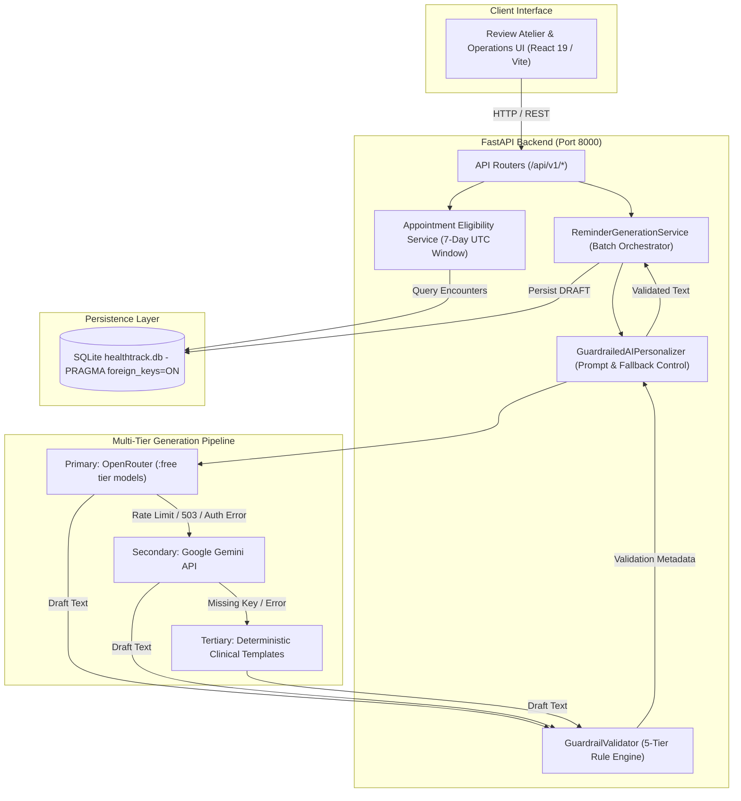
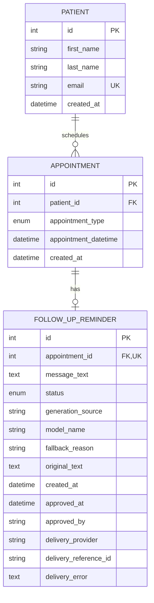
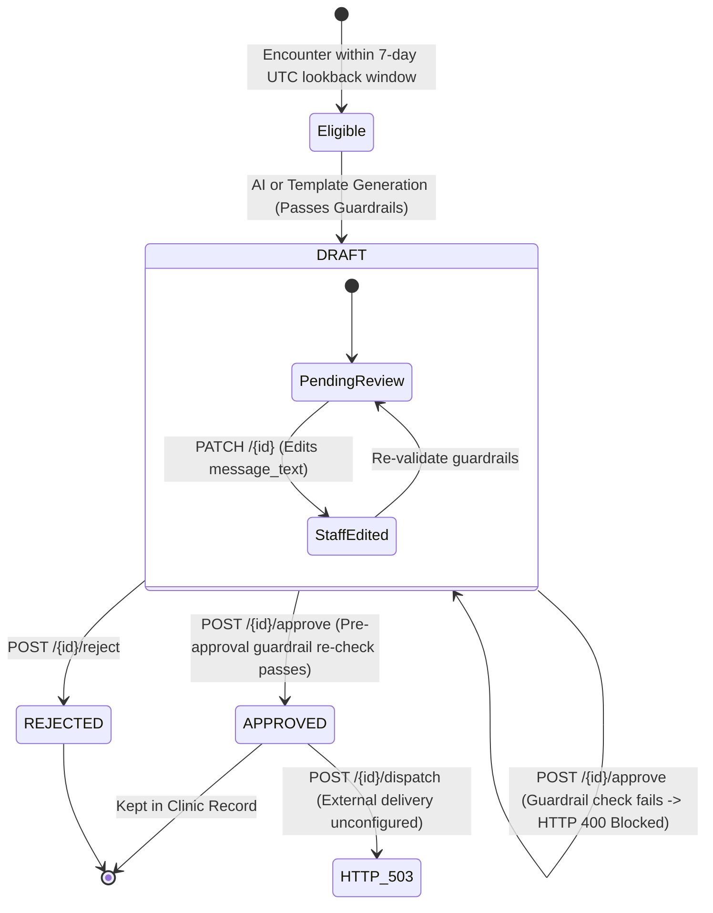

# HealthTrack — AI-Driven Patient Follow-Up System

HealthTrack is an administrative healthcare backend and review atelier designed to automate, personalize, and validate post-encounter patient follow-up communications. Built for clinical care coordinators and healthcare operations administrators, HealthTrack bridges the gap between post-visit encounter data and empathetic patient communication while enforcing strict deterministic safety guardrails and human-in-the-loop oversight.

> **Project Assessment Submission**: AidenAI AI Engineer Build-Round<br/>
> **Repository**: [https://github.com/VaishnavSreekumar/Health_Tracker](https://github.com/VaishnavSreekumar/Health_Tracker)<br/>
> **Operational Status**: Fully Functional (FastAPI Backend + Vite/React 19 Atelier UI + Multi-Tier LLM Pipeline with Deterministic Fallback)

---

## 1. System Scope & Architecture

### 1.1 Key Capabilities
- **7-Day Retrospective Encounter Selection**: Identifies patient encounters completed within a deterministic 7-day UTC lookback window (`[reference_time - 7 days, reference_time)`), strictly excluding future scheduled appointments.
- **Multi-Tier Resilient Generation**: Primary LLM generation via OpenRouter (enforcing a strict zero-cost `:free` model policy), automated secondary failover to Google Gemini, and guaranteed tertiary fallback to deterministic clinical templates.
- **5-Tier Deterministic Safety Guardrails**: Pre-persistence and pre-approval validation enforcing character boundaries, patient greeting integrity, prompt injection isolation, clinical non-prescriptiveness, and structural sentence completeness.
- **Human-in-the-Loop Review Atelier**: Administrative interface allowing clinical staff to inspect draft provenance, edit message text, trigger live guardrail re-validation, approve, or reject drafts.
- **Safe Dispatch Boundaries**: Protects against accidental patient outreach by gating dispatch behind approved status and returning explicit HTTP 503 status when live transport adapters are unconfigured.

### 1.2 Explicit Non-Goals
- **No Direct Patient Portal**: HealthTrack is exclusively an internal clinical operations tool; patients do not log into the system.
- **No External Message Transmission**: External SMS/WhatsApp gateways (e.g., Twilio) and email providers (e.g., SendGrid) are unconfigured by default. The `/dispatch` endpoint explicitly rejects outbound transport with HTTP 503 to ensure zero unsanctioned patient communication during evaluation.
- **No Automated Clinical Diagnosis or Medical Triage**: The system strictly forbids generating clinical advice, diagnosis, prescription adjustments, or medical instructions.

### 1.3 System Architecture Diagram



---

## 2. Relational Data Models & Database Architecture

HealthTrack uses **SQLAlchemy 2.x** with a local SQLite database (`healthtrack.db`). SQLite foreign-key enforcement is enabled on connection via `PRAGMA foreign_keys = ON`. Timestamps are stored and normalized using timezone-aware UTC datetime wrappers (`UTCDateTime`).

### 2.1 Entity Model Specifications
- **`Patient` (`patients`)**: Primary patient entity storing `first_name`, `last_name`, synthetic unique `email`, and registration `created_at`.
- **`Appointment` (`appointments`)**: Clinical encounter linked to `Patient` via `patient_id`. Categorized by `AppointmentType` enum (`ROUTINE_CHECKUP`, `FOLLOW_UP`, `SPECIALIST_CONSULTATION`, `ANNUAL_PHYSICAL`, `POST_PROCEDURE`). Stores `appointment_datetime` (UTC) and `created_at`.
- **`FollowUpReminder` (`follow_up_reminders`)**: Follow-up message linked to `Appointment` via `appointment_id`. Enforces a strict one-reminder-per-appointment integrity constraint via a unique database index (`uq_follow_up_reminders_appointment_id`).
  - **Message & Status**: Stores `message_text`, optional `original_text` for review diffs, and `status` via `ReminderStatusType` mapping to `ReminderStatus` enum (`DRAFT`, `APPROVED`, `REJECTED`, `PENDING`, `SENT`, `FAILED`).
  - **Status Normalization**: `ReminderStatusType` transparently normalizes legacy lowercase database values (e.g. `draft`) while persisting canonical uppercase enum names (`DRAFT`, `APPROVED`, etc.) to storage.
  - **Operational Provenance**: Stores `generation_source` (`ai` or `template_fallback`), `model_name`, and `fallback_reason`.
  - **Human Review**: Stores `approved_at` and `approved_by`.
  - **Delivery Tracking**: Stores `delivery_provider`, `delivery_reference_id`, and `delivery_error` directly on the reminder entity.

### 2.2 Entity Relationship Diagram (ERD)



---

## 3. Reminder Generation, Safety Guardrails & Human-in-the-Loop Lifecycle

### 3.1 7-Day Lookback & Duplicate Prevention
- Encounter selection evaluates appointments matching `reference_time - 7 days <= appointment_datetime < reference_time`.
- Future appointments (`appointment_datetime >= reference_time`) are strictly excluded.
- Idempotency is guaranteed: encounters with an existing reminder record (`DRAFT`, `APPROVED`, `REJECTED`, etc.) are skipped during batch generation.

### 3.2 5-Tier Deterministic Guardrail Validation
Every generated or staff-edited message must pass the 5-tier guardrail filter (`app/services/guardrails.py`):
1. **Length Bounds**: Message length must be between 15 and 350 characters.
2. **Personalized Greeting**: Message must open with a personalized greeting addressing the patient by name (e.g., "Hello [Name]").
3. **Prompt & Injection Isolation**: Strict rejection of system prompt leakage, Markdown syntax, internal schema identifiers, bracketed template variables (e.g., `[Patient Name]`), or role markers (`SYSTEM:`, `ASSISTANT:`).
4. **Non-Prescriptive Clinical Safety**: Strict prohibition of medical diagnoses, prescription medication names, dosage instructions, or definitive clinical advice.
5. **Structural & Sentence Completeness**: Requires terminal punctuation (`.`, `!`, `?`), forbids abrupt truncation, and rejects sentences ending in dangling conjunctions or prepositions (`and`, `with`, `because`).

### 3.3 Human Review & Approval Gate
- **Draft Editing (`PATCH /api/v1/reminders/{id}`)**: Clinical staff can edit draft message text. The endpoint validates the new text against all guardrails before saving, preventing staff from introducing non-compliant language.
- **Pre-Approval Validation Re-run (`POST /api/v1/reminders/{id}/approve`)**: When clinical staff approves a reminder, the backend re-validates the current stored message against all guardrails. If the draft fails safety checks, approval is blocked with `HTTP 400 Bad Request`.
- **Rejection (`POST /api/v1/reminders/{id}/reject`)**: Draft reminders can be transitioned directly to `REJECTED` status.

### 3.4 Reminder Lifecycle State Machine



### 3.5 Delivery Dispatch Behavior & Logging
- **`POST /api/v1/reminders/{id}/dispatch`**: Verifies that the reminder is in `APPROVED` status. When no external SMS or email provider is configured, the endpoint returns **`HTTP 503 Service Unavailable`** with detail:
  ```json
  {"detail": "External message delivery provider is unconfigured. Safe local demonstration mode is active."}
  ```
  This guarantees that messages are never transmitted over live telecommunications networks during local testing or evaluation.
- **`GET /api/v1/delivery/logs`**: Queries `FollowUpReminder` records where status is in `SENT`, `FAILED`, or `PENDING` to inspect outbound delivery history.

---

## 4. API Reference

All API routes are prefixed under `/api/v1` (with the exception of `/health`).

### Core Endpoints

| Method | Path | Description | Key Parameters / Request Body | Response Status & Key Fields |
| :--- | :--- | :--- | :--- | :--- |
| `GET` | `/health` | System liveness, database connectivity, and configured LLM provider status. | None | `200 OK`: `{"status": "healthy", "database": "connected", "primary_provider": "...", "configured_model": "..."}` |
| `GET` | `/api/v1/patients/` | Retrieve list of registered patients. | None | `200 OK`: `List[PatientResponse]` (`id`, `first_name`, `last_name`, `email`, `created_at`) |
| `POST` | `/api/v1/patients/` | Register a new patient. | `{"first_name": "...", "last_name": "...", "email": "..."}` | `201 Created`: `PatientResponse` |
| `GET` | `/api/v1/appointments/` | Retrieve appointments with patient and reminder context. | `?eligible_only=false&reference_time=...` | `200 OK`: `List[AppointmentResponse]` |
| `POST` | `/api/v1/appointments/seed-qa` | Seed synthetic encounters for testing. | None | `200 OK`: `{"seeded": 5, "message": "..."}` |
| `GET` | `/api/v1/reminders/generate` | Batch generation endpoint (assessment evaluation contract). | `?window_days=7&reference_time=...&as_list=false` | `200 OK`: `ReminderGenerationResponse` (or `List[ReminderDetailResponse]` if `as_list=true`) |
| `POST` | `/api/v1/reminders/generate` | Standard RESTful batch generation trigger. | `{"window_days": 7, "reference_time": null}` | `200 OK`: `ReminderGenerationResponse` |
| `POST` | `/api/v1/reminders/appointments/{apt_id}/draft` | Generate or regenerate draft for a single encounter. | None (path parameter `appointment_id`) | `200 OK`: `ReminderDetailResponse` (`status="draft"`, provenance metadata) |
| `PATCH`| `/api/v1/reminders/{id}` | Edit draft message text. Automatically re-evaluates guardrails. | `{"message_text": "Updated reminder text..."}` | `200 OK`: `ReminderDetailResponse` (`is_edited=true`, updated validation breakdown) |
| `POST` | `/api/v1/reminders/{id}/approve` | Approve draft. Enforces live guardrail re-validation. | None (path parameter `reminder_id`) | `200 OK`: `ReminderDetailResponse` (`status="approved"`, `approved_at`, `approved_by`) |
| `POST` | `/api/v1/reminders/{id}/reject` | Reject draft. Transitions status directly to rejected. | None (path parameter `reminder_id`) | `200 OK`: `ReminderDetailResponse` (`status="rejected"`) |
| `POST` | `/api/v1/reminders/{id}/dispatch` | Message dispatch boundary. Returns 503 when external transport is unconfigured. | None (path parameter `reminder_id`) | `503 Service Unavailable`: Safe unconfigured notice |
| `GET` | `/api/v1/delivery/logs` | Retrieve outbound transmission log for reminders. | None | `200 OK`: `List[dict]` (`reminder_id`, `status`, `provider`, `reference_id`, `error_detail`) |
| `POST` | `/api/v1/system/reset` | Clear operational records to return to an empty workspace. | None | `200 OK`: `{"status": "success", "message": "All workspace records cleared."}` |

#### Batch Generation Parameters (`GET` & `POST /api/v1/reminders/generate`)
- `window_days` (integer, default: `7`, range: `1` to `90`): Number of past days to inspect for completed encounters.
- `reference_time` (datetime, optional): Anchor timestamp in UTC for controlled replay and evaluation. Defaults to current UTC time.
- `as_list` (boolean, default: `false`, `GET` only): When `true`, returns a flat JSON array of reminder records (`List[ReminderDetailResponse]`). When `false`, returns the full `ReminderGenerationResponse` containing summary metrics (`total_reviewed`, `reminders_created`, `reminders_skipped`, `failures`, `created_reminder_ids`, `reminders`).

---

## 5. Prerequisites & Verified Setup

### 5.1 System Prerequisites
- **Python**: 3.11 or newer
- **Node.js**: 18.0 or newer with `npm`
- **Git**

### 5.2 Backend Installation & Setup

1. **Clone the repository**:
   ```bash
   git clone https://github.com/VaishnavSreekumar/Health_Tracker.git
   cd Health_Tracker
   ```

2. **Create and activate a virtual environment**:
   ```bash
   # Windows PowerShell
   python -m venv .venv
   .venv\Scripts\Activate.ps1

   # Linux / macOS
   python3 -m venv .venv
   source .venv/bin/activate
   ```

3. **Install Python dependencies**:
   ```bash
   pip install -r requirements.txt
   ```

4. **Configure environment variables**:
   ```bash
   # Windows PowerShell
   Copy-Item .env.example .env

   # Linux / macOS
   cp .env.example .env
   ```

### 5.3 Frontend Build

The frontend is built using React 19 and Vite. The compiled static bundle is located in `frontend/dist` and is served directly by FastAPI.

To compile the frontend:
```bash
cd frontend
npm install
npm run build
cd ..
```

---

## 6. Environment Configuration

All settings are managed via [`app/core/config.py`](file:///C:/Users/vaish/.gemini/antigravity-ide/scratch/healthtrack/app/core/config.py) through Pydantic BaseSettings. Sensitive keys must be placed in `.env` (which is excluded by `.gitignore`).

### Configuration Variables (`.env.example`)

```env
# Application Settings
PROJECT_NAME="HealthTrack Follow-Up System"
CLINIC_NAME="HealthTrack Clinic"
ENVIRONMENT="development"
DEBUG=true

# Database Configuration (SQLite local file)
DATABASE_URL="sqlite:///./healthtrack.db"

# LLM Provider Configuration
# Supported options:
#   "openrouter"                       - OpenRouter primary, deterministic fallback on failure
#   "gemini"                           - Google Gemini primary, deterministic fallback on failure
#   "openrouter_with_gemini_fallback"  - OpenRouter primary -> Google Gemini backup -> deterministic fallback
#   "none"                             - Fully offline using deterministic templates
LLM_PROVIDER="openrouter"

# OpenRouter Configuration (Primary Free Provider)
# STRICT ZERO-COST POLICY: Model name MUST contain the ':free' suffix.
OPENROUTER_API_KEY="replace_with_your_own_openrouter_key"
OPENROUTER_MODEL="nvidia/nemotron-3-ultra-550b-a55b:free"
OPENROUTER_BASE_URL="https://openrouter.ai/api/v1"
OPENROUTER_SITE_URL=""
OPENROUTER_APP_NAME="HealthTrack"

# Google Gemini Configuration (Optional Secondary Backup Provider)
GEMINI_API_KEY="your-gemini-api-key-here"
GEMINI_MODEL="gemini-3.6-flash"

# Global LLM Request Timeout (seconds)
LLM_TIMEOUT_SECONDS=15.0
```

> **Strict Zero-Cost Policy**: If `OPENROUTER_MODEL` does not end with `:free`, the backend will reject execution or fall back safely to prevent inadvertent charges.

---

## 7. Running the Application

### 7.1 Unified Production Server
Run the FastAPI application with Uvicorn. This serves both the API endpoints and the compiled React UI:

```bash
uvicorn app.main:app --host 127.0.0.1 --port 8000 --reload
```

- **Application Web Atelier**: [http://127.0.0.1:8000](http://127.0.0.1:8000)
- **Interactive Swagger Docs**: [http://127.0.0.1:8000/docs](http://127.0.0.1:8000/docs)
- **ReDoc Documentation**: [http://127.0.0.1:8000/redoc](http://127.0.0.1:8000/redoc)

### 7.2 Independent Frontend Development Server (Optional)
If modifying frontend components with live hot-reloading:

```bash
cd frontend
npm run dev
```
*Vite dev server starts on `http://localhost:5173` and proxies API requests to `http://localhost:8000`.*

---

## 8. Automated Testing & Offline Evaluation

### 8.1 Automated Test Suite
The repository includes a comprehensive `pytest` suite validating models, API endpoints, guardrails, database isolation, and provider clients without requiring network connectivity.

Run all tests:
```bash
pytest -v
```

Run provider and guardrail tests specifically:
```bash
pytest -v tests/test_guardrails.py tests/test_openrouter.py
```

*Status: 114 verified passing tests across 8 test suites.*

### 8.2 Reproducible AI Evaluation Harness
HealthTrack provides a standalone evaluation harness that benchmarks model and guardrail behavior across 16 synthetic clinical cases:

```bash
python -m evals.run
```
*Demonstrates a 100% pass rate under active guardrail enforcement with 0 unsafe outputs accepted.*

---

## 9. Architecture Decisions & Trade-Offs

1. **Deterministic Template Fallback vs. Endless Retries**:
   - Rather than blocking clinical workflows with unbounded retry loops when external LLM providers experience rate limits (HTTP 429) or downtime (HTTP 503), HealthTrack falls back immediately to deterministic clinical templates. This guarantees high availability and zero operational stalls.
2. **SQLite with `PRAGMA foreign_keys = ON`**:
   - Chosen for zero-setup local evaluation while maintaining relational integrity. Foreign key constraints and unique constraints prevent orphaned follow-up records or duplicate reminders.
3. **Guardrail-Enforced Human Approval**:
   - Allowing staff to edit draft messages introduces the risk of human-introduced compliance violations. HealthTrack mitigates this by re-evaluating edited messages against the 5-tier guardrail suite upon approval submission.
4. **Unified Single-Port Deployment**:
   - FastAPI serves the pre-compiled Vite production bundle from `frontend/dist`. This eliminates CORS issues and simplifies deployment for evaluators.

---

## 10. AI Usage Disclosure

In adherence to assessment transparency requirements, this section documents AI tooling used in this project:
- **Tools**: Google DeepMind Antigravity / Gemini coding assistance.
- **Assisted Areas**:
  - Drafting initial Pydantic schema structures and regex patterns for sentence completeness.
  - Designing UI components for the atelier decision panel and audit table.
  - Formulating edge cases for the synthetic offline evaluation harness.
- **Subsequent Human Verification**:
  - Validated all database relationships, foreign key constraints, and cascading rules.
  - Implemented the custom `ReminderStatusType` to resolve legacy SQLite enum case mismatches.
  - Confirmed privacy-safe logging across all provider clients (redacting tokens and patient details).
  - Verified test isolation fixtures and non-destructive database operations.

---

## 11. Known Limitations & Future Work

- **External Delivery Unconfigured**: Message dispatch (`POST /api/v1/reminders/{id}/dispatch`) returns HTTP 503 by design. Production deployment would implement authenticated external SMS (Twilio) and email (SendGrid) transport adapters.
- **Single-Tenant Prototype**: Current endpoints operate without multi-tenant authentication or role-based access control (RBAC).
- **Background Task Queue**: Batch generation currently executes synchronously within the request cycle. Production scaling would offload batch processing to Celery or ARQ with Redis.
